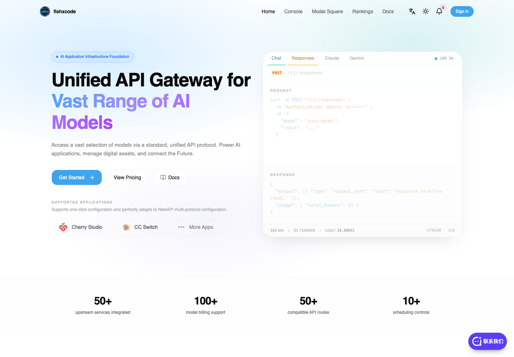
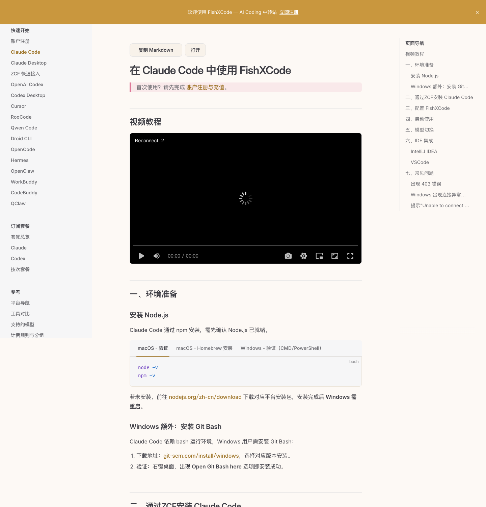
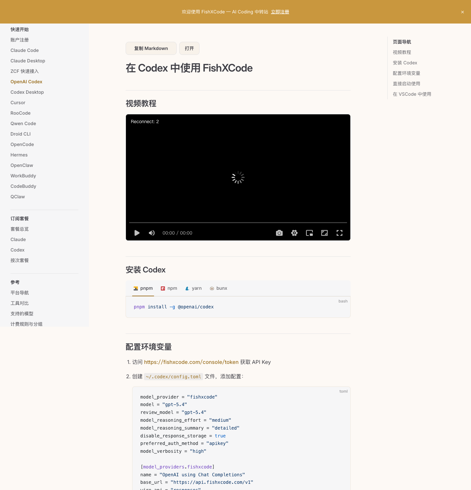
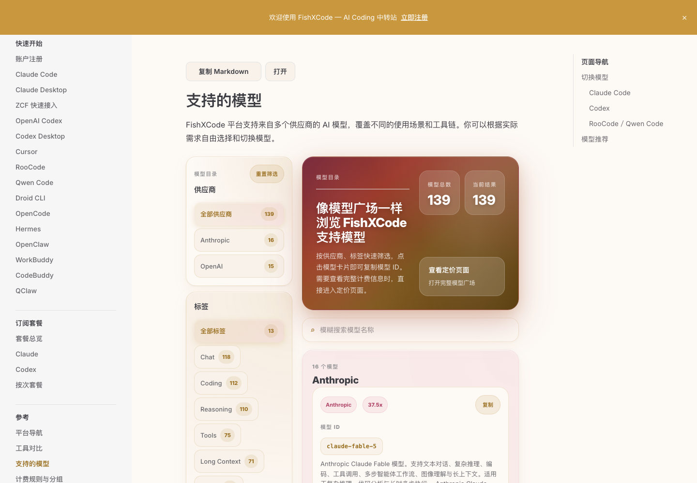

# FishXCode 鱼代码：Claude Code / Codex 多分组与订阅怎么选（2026）

**选择结论：**FishXCode 适合以 Claude Code、Codex、Roo Code 或 Qwen Code 为主要工作流，并希望在按量、订阅套餐和多资源分组之间选择的开发者或团队。第一次从按量余额开始，用 Haiku 或 Sonnet 完成真实编码任务；调用稳定且每月用量可预测后，再比较订阅套餐。

[通过本站入口开始 FishXCode](https://fishxcode.com/sign-up?aff=HOvo)



## 为什么值得买

FishXCode 的定位很集中：围绕 AI Coding 做接入文档，覆盖 Claude Code、OpenAI Codex、Roo Code、Qwen Code、Droid 和 OpenCode。平台同时提供按量余额、订阅套餐与令牌分组，既能支持临时测试，也能让固定预算团队按月管理。

它的文档不只给 Base URL，还解释如何创建 Key、选择分组、核用量和处理常见错误。对需要多个上游资源池的团队，Key 与分组绑定能把项目、模型和成本拆开管理。

## 适合谁 / 不适合谁

**适合：**

- Claude Code / Codex 是日常生产工具的开发者；
- 想在按量与订阅之间比较真实月成本的人；
- 需要每个项目独立 Key、分组和预算的团队；
- 需要支付宝、微信或兑换码充值的人。

## 公开价格：按量先验证

FishXCode 公开模型页当前展示多个 Claude 档，单位为美元 / 1M tokens：

| 模型 | 输入 | 输出 | 缓存读取 | 推荐用途 |
|---|---:|---:|---:|---|
| `claude-haiku-4-5` | $0.18 | $0.90 | $0.018 | 连接验证、轻量编码、抽取 |
| `claude-sonnet-4-5-20250929` | $0.54 | $2.70 | $0.054 | 固定版本的日常编码 |
| `claude-sonnet-4-6` | $0.54 | $2.70 | $0.054 | Claude Code 主力任务 |
| `codex-auto-review` | $1.50 | $9.00 | $0.15 | 自动代码审查 |

模型页还显示不同端点与分组。相同 Model ID 在不同 Key 分组下会走不同资源池，最终应以控制台所选分组与调用日志为准。

[查看 FishXCode 并先做按量测试](https://fishxcode.com/sign-up?aff=HOvo)



## 按量、订阅、按次套餐怎么选

FishXCode 有三种购买逻辑：

| 入口 | 核心计量 | 更适合 |
|---|---|---|
| 按量余额 | 输入、输出、缓存与分组倍率 | 临时测试、多模型混用、月用量波动 |
| 订阅套餐 | 价格、有效期、额度、每日 / 每月上限 | 用量稳定、固定预算团队 |
| 按次套餐 | 成功请求次数、日上限、月上限、总次数 | 请求大小较一致的 Claude / Codex 任务 |

按次套餐里，Claude Opus 4.8 与 GPT-5.5 按 `2.5 × 实际成功请求次数` 累计。比较套餐时不能只看“总次数”，还要看高阶模型的折算、每日上限、有效期和适用分组。

**购买顺序：**先按量跑一周，算出每天请求数、平均输入 / 输出 token 和峰值；再把真实成本与套餐价格比较。若任务长度差异很大，按量通常更透明；若调用频率稳定且套餐上限匹配，再切订阅。

## Claude Code 怎么接

FishXCode 文档给出的关键变量是：

```text
ANTHROPIC_BASE_URL=https://api.fishxcode.com/
ANTHROPIC_AUTH_TOKEN=你的 API Key
ANTHROPIC_MODEL=从模型页复制的 Model ID
```

先安装 Claude Code，在控制台创建专用 Key，再选择分组。日常开发用 Sonnet；轻量文件搜索、问答和小改动用 Haiku。为防止 Key 泄漏，不要写进 Git 配置文件；使用环境变量或本机 secrets。



## Codex 与多工具工作流

Codex 在 `~/.codex/config.toml` 中配置 provider、Base URL、Key 和模型。Roo Code / Qwen Code 在提供商设置里选择自定义模型。每种工具单独一把 Key，可以从日志识别哪个工作流消耗最多，也能独立停用。

FishXCode 的模型页列出 Claude、Codex 及其他模型，切模型时必须使用完整 ID。不要让客户端在模型不可用时自动无限回退；设定允许模型列表、最大重试和请求超时。



## 充值、分组与风险

公开文档给出的充值方式包括支付宝、微信和兑换码。分组名称中的倍率会影响消费：较小倍率能使用更多 token，但购买决策还要同时看模型范围、资源池和实际稳定性。一个低倍率分组如果频繁失败重试，最终成本仍会升高。

FishXCode 是 API 中转层。不要提交密码、私钥、生产数据库内容、未脱敏客户代码或受监管数据。团队使用时把成员、项目和客户端拆成不同Key，账单更清楚。

## 购买前检查清单

1. 用按量余额跑一周真实工作流；
2. Key 按 Claude Code、Codex、自动审查分别创建；
3. 记录每次任务的输入、输出、缓存和重试；
4. 核套餐有效期、日上限、月上限、总次数与模型折算；
5. 确认 Key 分组包含目标 Model ID；
6. 大额或企业采购前补齐退款、隐私、日志与 SLA；
7. 只上传允许第三方模型处理的数据。

## FAQ

### 先买订阅还是先按量？
先按量。只有真实月用量稳定、套餐上限与模型范围匹配时，订阅才更容易省钱。

### Claude Code 从哪个模型开始？
连接验证用 Haiku，日常开发用 Sonnet。大型重构再切更高档模型。

### 0.5x 倍率是什么意思？
它是分组消费倍率，不等于所有模型都自动半价。还要核模型范围、基础价格和最终日志。

### 按次套餐适合长任务吗？
先看一次请求的折算和模型规则。Opus 4.8、GPT-5.5 会按 2.5 倍成功请求次数累计。

### API Key 放在哪里？
放环境变量或受控 secrets，不进公开仓库、截图、聊天记录和前端代码。

## 最终建议

FishXCode 的优势是围绕 AI Coding 把文档、模型、分组和套餐放在一起。先用按量余额验证 Claude Code / Codex，再用一周数据选择订阅，比直接买套餐更可控。

[通过本站入口开始 FishXCode 按量验证](https://fishxcode.com/sign-up?aff=HOvo)

## fish替代方案与相关搜索

可对比的方向包括官方API、单一Coding专线和多模型中转；选择时结合价格、充值、接入与自己的常用客户端。

相关搜索：fish价格、fish充值、fish Claude Code、fish Codex。
